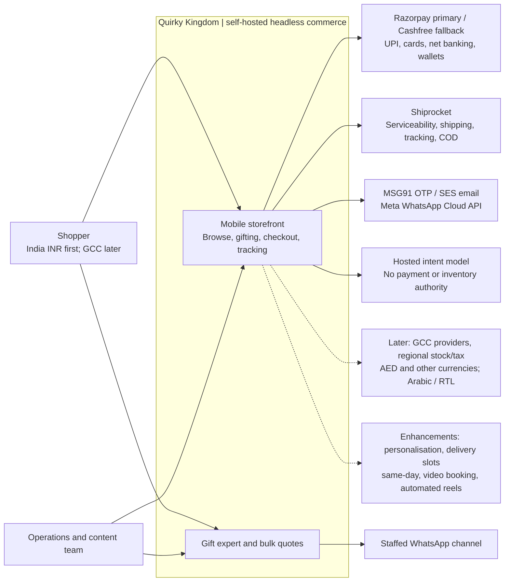
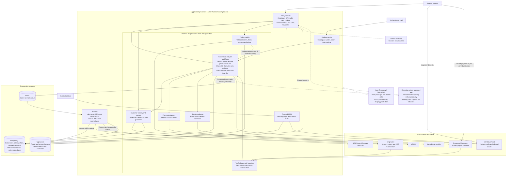
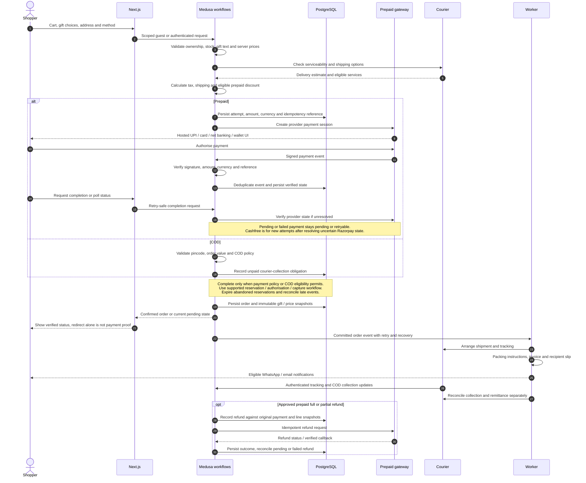
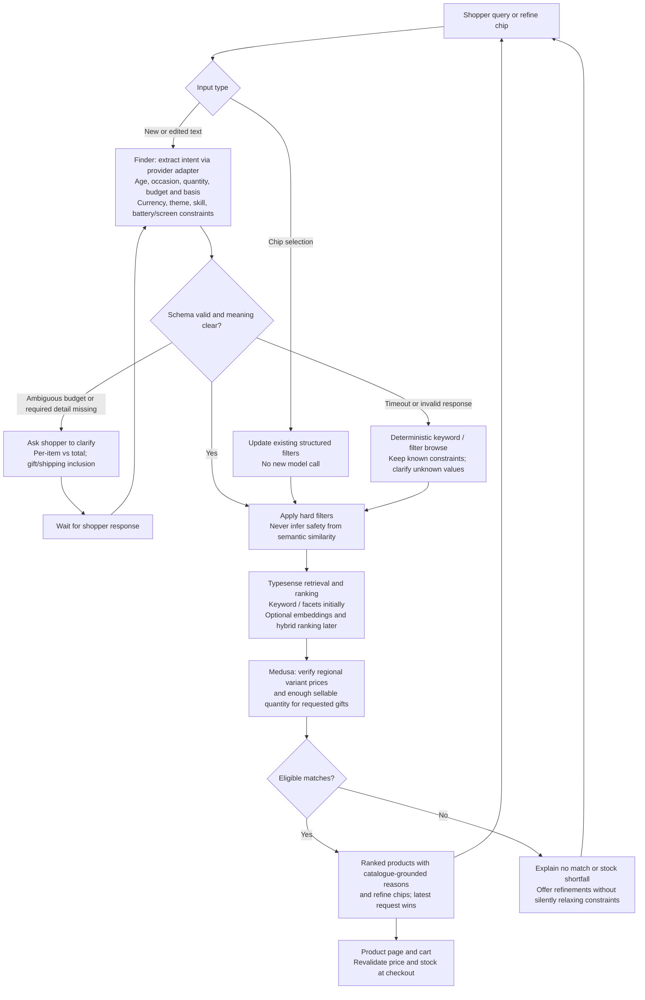

# Quirky Kingdom Technical Plan

**Issue:** GENERALPRO-1 · **Updated:** 5 November 2026 · **Status:** Planning recommendation, ready for stakeholder review.

Quirky Kingdom is a mobile-first store for trending and STEM toys, with gifting as its main differentiator. Launch in India with INR; prepare for UAE/GCC currencies, regional operations and Arabic/RTL without replacing the commerce engine.

**Recommendation:** Self-host Medusa v2, Next.js, PostgreSQL, Redis and Typesense. Use Razorpay as the primary prepaid gateway and Cashfree as the fallback. Keep custom gifting and AI logic in modules, with background workers for integrations. No monthly commerce-platform licence is required.

**Planning assumptions:** TypeScript team, one Indian legal entity, one recipient per order, approximately 3,000 SKUs and 500 orders/month initially. Scope, budgets and delivery dates require approval. This document specifies a design; checkout, adapters and capacity have not yet been proven in a project prototype.

## 1. Commerce platform decision

| Criterion | Medusa v2 | Saleor | Vendure |
|---|---|---|---|
| Core licence | MIT | BSD-3-Clause | GPLv3; review plugin exception/commercial terms |
| Team fit | TypeScript, REST | Python core; GraphQL and TypeScript apps | TypeScript, GraphQL |
| Gifting and personalisation | Modules/workflows and custom server pricing | Apps/webhooks; custom pricing design needed | Plugins, custom fields and configurable-product pricing |
| Bundles | Custom workflow and stock rules | App/model design | Plugin/model design |
| Regions/currencies | Regions and price configuration | Channels and currencies | Channels and currencies |
| Admin | Extend for packing and gift details | Dashboard/app extension | Custom fields/admin extension |
| Community/maturity | Established OSS ecosystem; evaluate v2-specific integrations | Established headless ecosystem; Python operations knowledge useful | Established TypeScript ecosystem; plugin-oriented |
| Performance/hosting | API, worker, database and Redis | API, workers, database and supporting services | API, worker, database and configured job infrastructure |
| Main tradeoff | Integration and gifting validation remain our responsibility | Extra core-runtime expertise | Licensing review and GraphQL preference |

All three require hosting and custom India integrations. No comparable load test or admin usability trial has established a performance or cost winner.

**Why Medusa:** Its permissive licence, TypeScript core and REST/workflow approach fit this team and a custom gifting checkout. Vendure is the closest alternative and already documents wrapping/engraving pricing. Saleor remains viable because extensions can use TypeScript even though its core is Python. The recommendation reflects project fit, not universal superiority.

**Validation gate:** Pin supported versions; demonstrate two differently personalised copies of one variant, correct server-priced surcharges, quantity/stock checks, packing instructions and a partial refund. Reject client price tampering. Reconsider Vendure if this requires fragile core overrides.

Technical basis: [Medusa personalisation](https://docs.medusajs.com/resources/recipes/personalized-products), [Saleor apps](https://docs.saleor.io/developer/extending/apps/overview), [Vendure configurable products](https://docs.vendure.io/guides/how-to/configurable-products/).

## 2. Full stack and operating cost

| Layer | Choice and purpose | Main tradeoff |
|---|---|---|
| Storefront | Next.js, React, TypeScript, Tailwind; responsive pages and server rendering | Requires caching/media discipline |
| Commerce/admin | Self-hosted Medusa v2; catalogue, cart, orders, pricing, inventory | Custom gift/admin extensions |
| Database | PostgreSQL; authoritative commerce and extension records | Backups and migration ownership |
| Cache/jobs | Redis with supported Medusa providers; workers handle retries | Pin a compatible OSS-licensed release |
| Search | Self-hosted Typesense; filters, typo tolerance and later hybrid search | Index synchronisation and memory |
| Editorial CMS | Self-hosted Payload; landing pages, buying guides and curated reels | Separate editorial administration |
| Media | S3 and CloudFront; optimised images, controlled video embeds | Storage and transfer charges |
| Identity/messages | MSG91 OTP, Amazon SES email, Meta WhatsApp Cloud API | Usage fees and onboarding |
| Analytics/monitoring | Self-hosted Umami; OpenTelemetry and CloudWatch | Consent, retention and operating effort |
| Hosting/delivery | AWS Mumbai, containers, GitHub Actions; dev/staging/prod isolation | Team owns deployment and recovery |

Use OSS editions for application software and metered plans for external services. Medusa/Next.js/Payload use MIT; PostgreSQL has its own permissive licence; Typesense server uses GPLv3. Check exact dependency editions and Redis licensing when pinning versions. No paid CMS or messaging subscription is assumed.

### Search alternatives

| Engine | Advantage | Disadvantage | Decision |
|---|---|---|---|
| Typesense | Shopping facets, typo tolerance and keyword/vector search in one engine | Additional service and index maintenance | Recommended for this catalogue |
| Meilisearch | Accessible search setup, facets and semantic capabilities | Edition/licence and workload sizing need checking | Strong alternative |
| OpenSearch | Extensive query, aggregation and search-pipeline controls | More operational complexity for a small catalogue | Use if requirements/team expertise justify it |

Start with keyword search and hard filters; enable hybrid ranking only after measuring relevance. Medusa remains authoritative for regional prices and sellable stock. Product events feed an idempotent index worker with retries, deletion handling and full rebuild support. [Typesense search documentation](https://typesense.org/docs/30.2/api/search.html).

### Hosting and budget

**Launch proposal:** One 16 GB application host running separate storefront, API, worker, CMS, Redis and search processes, plus managed PostgreSQL and separate staging. Sharing a host keeps costs down but creates a shared failure domain. Move search and workers onto separate capacity as measurements justify it; use redundant API instances and database failover before committing to high availability.

AWS offers a path to managed databases, queues and regional infrastructure. A single VPS with managed PostgreSQL is a simpler alternative but leaves more recovery/security work with the team. Render/Railway can simplify deployment; confirm region, fixed plan charges and equivalent resource costs before choosing them.

**Monthly planning allowances, USD, not vendor quotations:**

| Cost category | Launch | Growth |
|---|---:|---:|
| Application/search/cache compute | 90–150 | 350–700 |
| Database, storage and backups | 50–100 | 200–400 |
| CDN, logs and networking | 20–60 | 100–250 |
| Separate staging | 25–60 | 75–150 |
| AI, OTP, email and WhatsApp | 40–100 | 200–600 |
| **Total** | **225–470** | **925–2,100** |

Launch assumes 50,000 visits, 10,000 Finder queries and 500 orders/month. Growth assumes 1 million visits, 200,000 queries and 10,000 orders/month, with redundant application capacity and separated search/cache. These are sizing assumptions, not demonstrated capacity.

As a price anchor, AWS lists a Linux Lightsail 16 GB/4 vCPU bundle at $84/month; actual region, transfer allowances and the complete deployment must be checked. Budget networking/load balancing explicitly when moving to ECS. Exclude payment fees, shipping, taxes, development and support labour. Reprice before purchase and validate memory under realistic catalogue/load tests. [AWS pricing](https://aws.amazon.com/lightsail/pricing/).

## 3. Payments

**Primary: Razorpay. Fallback: Cashfree.** Razorpay offers the required prepaid methods and hosted checkout with straightforward published base pricing. Cashfree provides a second provider with overlapping coverage. This is an integration choice, not evidence of better payment success rates.

Published pricing checked 5 November 2026; merchant agreements control actual rates and settlement.

| Gateway | Methods | Fee indication | Settlement and integration |
|---|---|---|---|
| [Razorpay](https://razorpay.com/pricing/) | UPI, cards, net banking, wallets; activation varies | Standard 2% plus applicable taxes; exceptions apply | Standard domestic T+2 working days after capture, subject to approval |
| [Cashfree](https://www.cashfree.com/payment-gateway-charges/) | UPI, cards, net banking, wallets; confirm enabled modes | Public page shows 1.95% and a conditional 0% promotion; do not budget on promotion | Advertises next-day settlement; contract controls eligibility |
| [PhonePe PG](https://business.phonepe.com/payment-gateway/pricing) | UPI, cards, net banking; confirm wallet coverage | Public free offer against 1.99% reference rate; conditions apply | Obtain merchant settlement schedule |
| [PayU](https://payu.in/pricing/) | UPI, cards, net banking, wallets | 2% domestic cards/net banking/wallets; UPI quote varies | Standard T+2 working days; optional faster settlement |

Settlement sources: [Razorpay](https://razorpay.com/docs/payments/settlements), [PayU](https://docs.payu.in/docs/faqs-for-dashboard).

**Plugins and refunds:** No Medusa v2 adapter has been validated here for any shortlisted gateway. Budget a payment-provider adapter; accept a maintained plugin only after version, licence, security and refund testing. For each provider, verify full/partial refunds, refund-status lookup, callbacks, processing time and whether original fees are returned. Confirm method-specific charges, refund/instant-settlement charges and KYC before signing.

**Checkout rules:** Use hosted gateway UI; never store card details. Server-side totals include gifting, taxes, shipping and eligible prepaid discounts. Verify callback signatures, amount, currency and payment reference; persist deduplication and reconciliation records in PostgreSQL. A browser redirect does not prove payment. Handle delayed success, abandoned reservations and partial refunds safely.

**Fallback:** Route new attempts to Cashfree only after resolving any uncertain Razorpay attempt. Begin with an operator-controlled runbook; do not blindly retry a charge across gateways.

**COD:** Use a separate manual/COD flow with pincode/value eligibility. Track placement, delivery, courier cash collection and remittance separately. Agree the return-to-origin and refund/payout process.

**GCC later:** Evaluate Stripe UAE, Checkout.com and Telr for the selected entity/country; add Tabby/Tamara only if buy-now-pay-later is required. Validate acquiring, currencies, settlement and refund support before enabling a region.

## 4. AI Toy Finder

The Finder turns natural language into catalogue filters and ranked products. It starts as a Medusa module with provider adapters and strict timeouts; it can become a separate service if traffic demands it.

1. Extract age, occasion, quantity, budget, currency, theme, skill and constraints into a validated schema.
2. Clarify ambiguity: “20 kids under ₹300” needs per-item versus total-budget confirmation. Show whether wrapping/shipping are included.
3. Apply hard age/safety, price and product filters; retrieve candidates from Typesense.
4. Rank by relevance, optionally combining keywords and product embeddings. Recheck regional prices and sufficient sellable quantity through commerce.
5. Return catalogue-grounded reasons and refine chips. Chip changes reuse intent without another LLM call.

**Product data:** Age bounds, occasion/theme/skill/category, safety/materials, battery-free and screen-free flags, variant prices, regional availability and personalisation eligibility. Missing safety facts remain unknown; semantic similarity never establishes age safety.

**Models:** Evaluate Anthropic Claude Haiku 5.5 for extraction against Sonnet 5.5 for quality. Keep a provider interface so another hosted model can be evaluated without changing checkout. Availability and structured-output behaviour require account-level testing.

At published short-prompt rates, 1,000 input + 200 output tokens cost approximately **$0.0002/query for Haiku** or **$0.004 for Sonnet**: about **$2/$40 per 10,000 calls**. Formula: (input tokens × input rate + output tokens × output rate) / 1,000,000. Excludes retries, embeddings and taxes. Template reasons avoid a second call. [Anthropic pricing](https://platform.claude.com/docs/en/about-claude/pricing).

**Reliability:** Target end-to-end p95 below 3 seconds, with a 2-second extraction timeout. On failure, offer deterministic keyword/filter search. No invented products or relaxed safety constraints. Rate-limit requests, redact personal details and version prompts/models. Test ambiguous budgets, stock shortfalls, unknown attributes, no matches, malformed output, prompt injection and rapid refinements before launch.

## 5. Feature and integration map

Phase assignments are proposals. Deferring a feature requires stakeholder agreement; it does not remove the requirement.

| Customer capability | Implementation/integration | Proposed phase |
|---|---|---|
| Browse by age, occasion, theme, STEM skill, category; trending | Medusa taxonomy + Typesense + Next.js | India |
| Product colour variants, safety/materials, “why kids love it”, gift cross-sells | Product fields, editorial content and storefront | India |
| Signature/Boys/Girls/Unisex/Eco kraft wraps, handwritten note up to 200 characters | Gift module + packing instructions | India |
| Recipient address and hide-price preference | Order snapshot + recipient slip; billing interpretation needs approval | India |
| Guest checkout, +91 phone OTP and order tracking | Medusa + MSG91 + authenticated/signed tracking access | India |
| UPI/cards/net banking/wallets/COD and prepaid discount | Payment adapters and server eligibility rules | India |
| Pincode check, earliest delivery estimate, labels and tracking | Shiprocket; Delhivery direct if existing contract fits better | India |
| AI search, reasons and refine chips | Finder + Typesense + hosted LLM | India beta |
| WhatsApp order updates and separate marketing opt-in | Meta Cloud API + workers + consent records | India |
| Talk to a gift expert | WhatsApp contact entry and staffed support process | India |
| Bulk/return gifts | Quote form, stock review and approved draft order | India |
| Newsletter, mobile responsive pages | SES, subscription/unsubscribe records and Next.js | India |
| Viral products and Instagram reels | Payload manual curation; authorised media | India |
| Add-name personalisation with surcharge | Gift pricing workflow + supplier/packing process | Enhancement |
| Pick delivery date/slot, express same-day in selected cities | Capacity/cutoff rules + contracted local courier | Enhancement |
| Video-call booking | Booking/availability module + meeting link | Enhancement |
| Automatic Instagram feed | Eligible Meta API integration | Enhancement |
| AED/other currencies, regional payments, Arabic/RTL | Commerce regions + translated content + regional providers | GCC |

**Provider tradeoffs:** Meta Cloud API avoids assuming a BSP subscription but requires our own operational tooling. Gupshup/Interakt/WATI may simplify inbox/support; compare actual plans before adoption. Shiprocket consolidates courier operations; a direct Delhivery contract may suit established volume. Same-day coverage requires city-specific partner evaluation, not an assumed courier capability.

**Operations:** Onboard OTP templates and sender requirements; configure messaging templates and consent. Generate GST invoice PDFs with an accountant-approved format and exports. Keep a price-free recipient slip separate until “hide price on invoice” is clarified. Notifications and courier jobs retry asynchronously and never block order creation.

## 6. Architecture and data flows

Rendered copies (edit source of truth here, then sync): [`diagrams/quirky-kingdom-architecture.mmd`](./diagrams/quirky-kingdom-architecture.mmd). View in [`~/work/mermaid-viewer`](../mermaid-viewer) (`npm run dev`).

### System context

### Components

CMS and commerce use separate database ownership/schema boundaries. Credentials remain server-side; databases, Redis and search are private. Workers process committed order events with durable retries and reconciliation. The search index is rebuildable, not an order ledger.

### Checkout

Exact authorisation/capture and reservation timing follows the tested Medusa provider workflow. Completion can be retried safely; stale reservations must expire, and late payments require reconciliation.

### AI search

## 7. Data model and business rules

This is a conceptual model implemented through Medusa modules/links, not direct edits to its internal tables.

| Entity | Key information and relationships |
|---|---|
| Product → variants | Description, safety/materials, age bounds, battery/screen flags; variants contain colour/options and inventory references |
| Collections ↔ products | Age, occasion, theme, skill, category and trending groups |
| Region → prices/providers | Currency, price lists, tax/shipping/payment configuration; regional stock locations |
| Customer → orders | Verified phone identity; guest customer link optional; separate consent history |
| Cart → configured lines | Variant, quantity, stable gift-configuration ID |
| Gift configuration → line | Wrap, note, personalisation text, eligibility and configuration version |
| Order → line snapshots | Purchased item, gift choices, base/surcharge/tax breakdown and currency |
| Order → recipient/delivery | Shipping/billing addresses, hide-price preference, requested date/slot and confirmed promise |
| Order → payment attempts/refunds | Provider references, amounts, idempotency keys and reconciliation status |
| Order → fulfillments | Carrier/tracking, packing instructions, delivery state and COD collection/remittance |

Server workflows calculate surcharges; browser prices are never trusted. Different names/notes must remain distinct configured lines. Twenty identical gifts may share quantity 20; confirm whether wrapping and notes apply per unit or package. Snapshot purchased instructions and prices so later catalogue edits cannot change packing or refunds.

Require verified ownership or an expiring signed guest link to access orders. Phone number plus order ID is insufficient. Refunds use original snapshots and an explicit policy for personalised goods.

For GCC, separate currency, language, tax and fulfillment concerns. A shared commerce instance is the starting design; entity/residency requirements may require regional deployments of the same engine.

## 8. Non-functional requirements

| Area | Design/target |
|---|---|
| Security | OWASP review; validate external input, enforce customer/staff permissions, throttle OTP/search, secure cookies/CSRF, protect secrets and audit admin changes |
| Payments/privacy | Hosted card collection; determine actual PCI scope with provider. Encrypt transport/storage, minimise retained personal data and redact logs |
| Mobile/accessibility | Responsive layouts, keyboard support and WCAG 2.2 AA target |
| Performance | Mobile field p75: LCP ≤2.5s, INP ≤200ms, CLS ≤0.1; measure real users and representative devices |
| SEO | Server-rendered product/category pages, canonical URLs, sitemap, Product structured data; hreflang for regional locales |
| Scalability | Cache public content; isolate cart/account responses; scale API/workers/search from measured latency, queue lag and memory |
| Availability/recovery | Single-host launch accepts downtime risk; 99.9% requires redundancy/support. Proposed recovery point ≤24h and recovery time ≤4h |
| Backups | Database backups/PITR and media versioning; isolated restore drills with payment/order reconciliation |
| Observability | Trace IDs, error/latency dashboards; alert on failed webhooks, payment mismatch, queue/index lag and backup failure |
| Delivery | Isolated dev/staging/prod; synthetic data and sandbox credentials outside prod; CI lint/tests/build, migration checks and rollback plan |

Before launch, test complete prepaid/COD/refund journeys, gifting charges, authorisation failures, webhook retries, accessibility and backup restoration. Assign an owner for operational alerts.

## 9. Delivery plan and decisions

The planning spike is **2–3 days**. The implementation estimates below are separate, in **person-weeks**, not calendar weeks.

| India module | Effort |
|---|---:|
| Commerce/catalogue setup | 2–3 |
| Storefront, editorial pages and mobile UX | 4–6 |
| Checkout, primary gateway and COD | 2–3 |
| Gift Studio and packing | 2–3 |
| Search | 1–2 |
| Shipping | 1–2 |
| OTP/accounts | 1 |
| WhatsApp/email | 1–2 |
| AI Finder beta | 2–4 |
| Admin and invoicing | 1–2 |
| Infrastructure and CI/CD | 2–3 |
| **Engineering subtotal** | **19–31** |

Allow another **1–2 weeks for the fallback gateway** and **3–5 for integrated QA/UAT and release hardening**: **23–38 person-weeks before contingency**. These are rough estimates; design, catalogue preparation, merchant approval and stakeholder review remain dependencies.

**Enhancements:** Personalisation 1–2 weeks; date/slot/same-day 2–4; booking 1–2; automated reels 1–2; semantic-search tuning 1–2. **GCC:** provisionally 6–10 weeks for regional pricing/payments, tax/shipping, Arabic/RTL and testing, excluding legal/entity onboarding. Re-estimate after country selection.

**Main risks:** Gift pricing/line merging, poor catalogue attributes, delayed merchant onboarding, COD returns, unreliable delivery promises and single-host downtime. Address these with the checkout proof of concept, catalogue validation, early onboarding, explicit policies and recovery/load tests.

**Decisions for Karan:**

- Launch date, budget, staffing and approval of proposed feature deferrals.
- AI beta at launch; editorial/content ownership.
- Gift configuration per item/package, recipient count and personalisation/refund policy.
- COD limits, prepaid discount and supported delivery cities/cutoffs.
- Meaning of hide-price invoice; accounting and packing requirements.
- Inventory source, fulfillment owner, customer-support staffing and booking workflow.
- First GCC country/entity, warehouse, residency and recovery expectations.

**Next implementation gate:** Prove the Medusa gifting/checkout scenario, validate primary/fallback adapters and obtain merchant/courier quotes. Then approve scope and resource sizing before committing to delivery dates.

**Handoff:** Share this document's accessible link in the issue and hold a 30-minute walkthrough: decisions/constraints (5 min), architecture/gifting (8), payments/AI (7), cost/roadmap (5), open decisions (5). Publication and the walkthrough remain to be completed.
